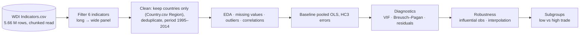
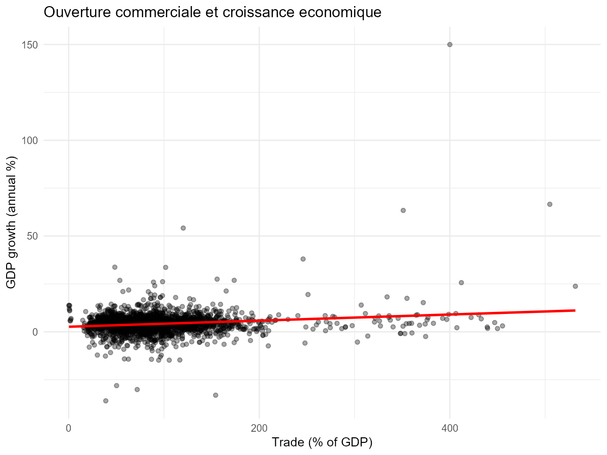
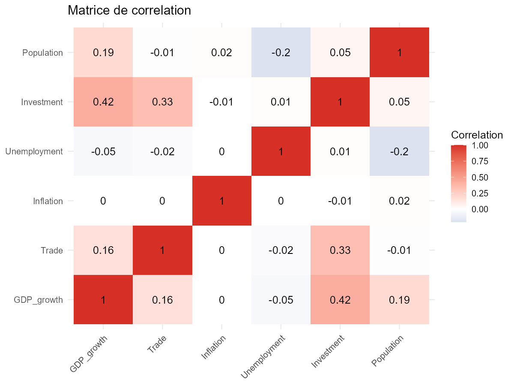
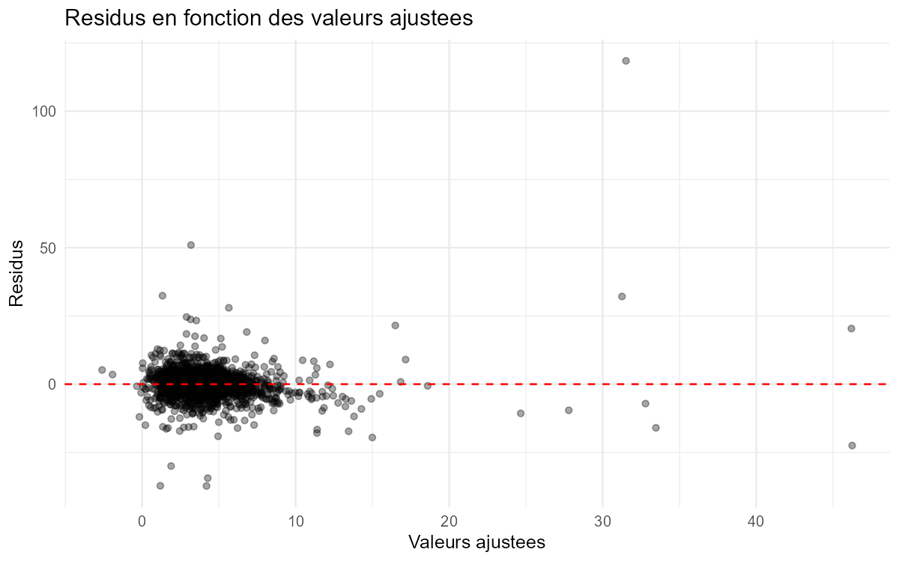
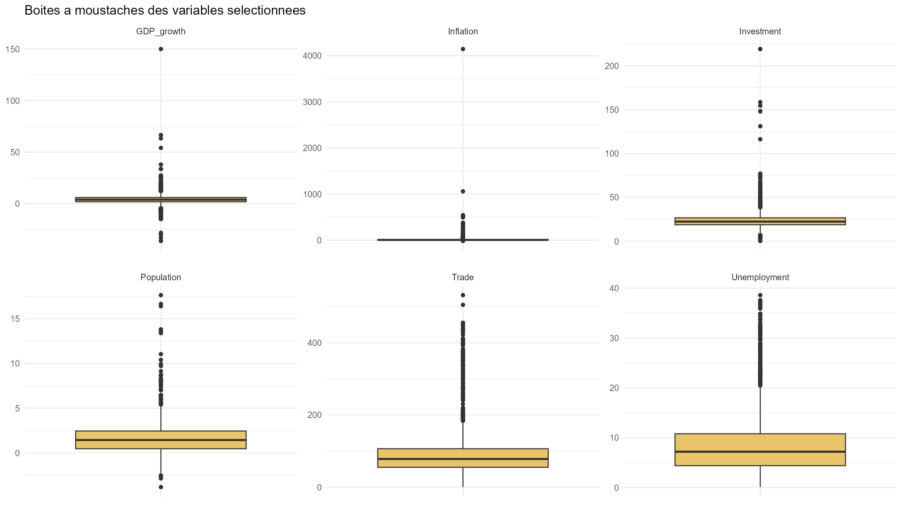

<div align="center">

# 📈 Trade Openness and Economic Growth — An Econometric Study with World Bank WDI

**Pooled OLS with HC3 robust errors, diagnostics, influence analysis, interpolation sensitivity and subgroup comparison — implemented in both Python and R.**


</div>

---

## 📌 Research Question

> To what extent is **trade openness** associated with **GDP growth** once macroeconomic controls are taken into account?

The study is deliberately framed as **conditional association, not causality**.

## 🗂️ Data

**World Development Indicators (World Bank)**, Kaggle version: ≈ 5.66 million rows in long format (country × indicator × year). Six indicators are extracted and pivoted to a country-year panel:

| Role | Indicator | Code |
|---|---|---|
| **Y** | GDP growth (annual %) | `NY.GDP.MKTP.KD.ZG` |
| **Main X** | Trade (% of GDP) | `NE.TRD.GNFS.ZS` |
| Control | Inflation, consumer prices (annual %) | `FP.CPI.TOTL.ZG` |
| Control | Unemployment (% of labour force) | `SL.UEM.TOTL.ZS` |
| Control | Gross capital formation (% of GDP) | `NE.GDI.TOTL.ZS` |
| Control | Population growth (annual %) | `SP.POP.GROW` |

**Analysis sample:** 1995–2014, **159 countries, 2,818 observations** (complete-case, no duplicate country-year pairs). The raw `Indicators.csv` is not versioned; `Country.csv`, `Series.csv` and the cleaned panel are.

## 🧭 Workflow



## 📊 Results

**Baseline model — pooled OLS, HC3 robust standard errors (n = 2,818, R² = 0.206)**

| Variable | Coefficient | Std. error | p-value |
|---|---:|---:|---:|
| Trade (% GDP) | 0.0031 | 0.0022 | 0.158 |
| Inflation | −0.00004 | 0.0055 | 0.994 |
| Unemployment | −0.0176 | 0.0183 | 0.339 |
| **Investment** | **0.2028** | 0.0498 | **< 0.001** |
| **Population growth** | **0.6089** | 0.0781 | **< 0.001** |

**Robustness and heterogeneity**

| Specification | n | Trade coef. | Trade p-value | Investment coef. | R² |
|---|---:|---:|---:|---:|---:|
| Baseline (complete-case) | 2,818 | 0.0031 | 0.158 | 0.203 | 0.206 |
| Without influential observations | 2,711 | 0.0026 | 0.012 | 0.141 | 0.145 |
| Interpolation sensitivity (linear, gap ≤ 2 years) | 2,825 | 0.0030 | 0.169 | 0.203 | 0.206 |
| Low-trade countries (79) | 1,409 | 0.0005 | 0.942 | 0.130 | 0.099 |
| High-trade countries (80) | 1,409 | 0.0068 | 0.051 | 0.224 | 0.262 |

**Diagnostics:** VIFs between 1.00 and 1.13 (no multicollinearity concern); Breusch–Pagan test rejects homoskedasticity (BP = 178.07, p < 2.2e-16), which motivates HC3 errors; simple Pearson correlation between trade and GDP growth r = 0.163 (95 % CI 0.127–0.199).

<p align="center">
  
  
</p>
<p align="center">
  
  
</p>

**Interpretation (as stated in the analysis).** Investment and population growth are the robust correlates of growth. The trade coefficient is **positive but fragile**: it is not significant in the baseline, becomes significant only after removing influential observations, and is concentrated in high-trade economies. These are **associations**, not causal effects (no instruments, no fixed effects, possible omitted variables and reverse causality).

## ✅ Verification Status

Every coefficient and p-value in the tables was cross-checked against the exported files in `r_outputs/tables/` (`baseline_hc3.csv`, `robustness_comparison.csv`, `subgroup_comparison.csv`, `vif_table.csv`, `breusch_pagan.txt`, `pearson_test.txt`, `ready_summary.csv`). The Python notebook and the R script were **not re-run** (the 5.6 M-row `Indicators.csv` is not in the repository; R is not installed on the verification machine).

## 🗂️ Repository Structure

```text
trade_growth_wdi_analysis.ipynb      Python notebook (statsmodels, seaborn)
trade_growth_wdi_analysis_R.Rmd      R Markdown version
trade_growth_wdi_analysis_R.R        Executable R script
build_and_execute_trade_growth_notebook.py   Generates / executes the notebook
trade_growth_clean_panel*.csv        Cleaned panels used in the analysis
Country.csv · Series.csv             WDI metadata
r_outputs/{plots,tables}/            R figures and exported tables
```

## 🧰 Tech Stack

| Role | Tools |
|---|---|
| Python | pandas, NumPy, statsmodels, SciPy, seaborn, matplotlib |
| R | tidyverse / ggplot2, broom, car, lmtest, sandwich, zoo, R Markdown |

## 🚀 Reproduce

1. Download the WDI dataset (`Indicators.csv`) — e.g. the [World Bank DataBank](https://databank.worldbank.org/source/world-development-indicators) or its [Kaggle mirror](https://www.kaggle.com/datasets/theworldbank/world-development-indicators) — into the project folder.
2. Python: open `trade_growth_wdi_analysis.ipynb` and run all cells.
3. R: `Rscript trade_growth_wdi_analysis_R.R` (or knit the `.Rmd`); outputs are written to `r_outputs/`.

## 🔭 Limitations & Future Work

- Pooled OLS ignores country and time heterogeneity — extend to **fixed/random-effects** panel models and clustered errors.
- Address endogeneity (instrumental variables, lagged regressors, system GMM) before any causal claim.
- Regional aggregates are excluded using `Country.csv`; the study period (1995–2014) is limited by the Kaggle snapshot.
- Plot titles/labels in the R figures are in French.

## 👤 Author

**Nour Ghribi** · [GitHub](https://github.com/Nour-Ghribi)

## 📚 References

- World Bank, *World Development Indicators*.
- MacKinnon & White (1985), HC3 heteroskedasticity-consistent covariance estimators.
